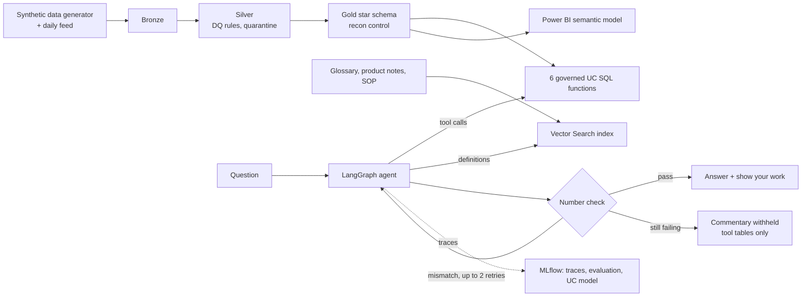

# Northlake CIB Performance Insights Agent

**Live demo: https://insights.inkandinfra.com**

An agent that tells CIB senior management **why a KPI moved and where the opportunity is**, built on Databricks for **Northlake Bank, a fictional bank**. Every client, deal and figure is synthetic.

- **Governed tools only:** the agent gets every number from six Unity Catalog SQL functions. Arguments are bound parameters, so the model never writes SQL.
- **One set of definitions:** RAG over the bank's glossary (Vector Search). The SQL functions, the Power BI measures and the agent all follow the same glossary.
- **A number check on every answer:** each figure in the draft must match a tool result. A mismatch sends the draft back; after two retries the commentary is withheld and only the tool tables are shown.
- **Evaluated:** 15 questions with planted answers, scored in MLflow (number accuracy, tool selection, groundedness, retrieval relevance, guardrails).
- **Controls built in:** daily data-quality rules and a GL reconciliation control, with an SOP the agent cites when a break appears.

## Try it

Open the [live demo](https://insights.inkandinfra.com) and ask:

| Question | What the answer should show |
|---|---|
| Why did Industrials revenue miss plan in Q3? | −$8.8M; two M&A mandates ($4.5M, $3.0M) slipped from August to November, 85% of the miss |
| Which clients are below the RAROC hurdle but have cross-sell whitespace? | 18 lending-only Mid-Market clients at 6–9% RAROC against a 15% hurdle |
| Which coverage teams are over capacity, and how is their win rate trending? | Coverage East 2: 14 clients per banker against 10; win rate 44% → 25% |
| Are there any reconciliation breaks? | $1.2M Transaction Banking break (June 2026), Severity 1, owner and escalation from the SOP |

Open **Show your work** under an answer to see the tool calls, the SQL, the definitions used and the number check. Questions about real banks are refused.

<!-- VIDEO: 2-minute walkthrough: VIDEO_URL -->
The **[executive dashboard](https://insights.inkandinfra.com)** (Power BI, interactive, no sign-in) sits under the chat on the same page ([open it full screen](https://app.powerbi.com/view?r=eyJrIjoiMGRhOGNjZDUtYTc0OS00MDY2LWFhMDYtYjQyMzJhOTFmM2UxIiwidCI6IjA5Y2Q3OWMxLWY0ZmEtNDVhZS05YjM5LTVhMjg5N2ZhNmE0NCJ9)).

## Architecture

The pipeline runs daily as a serverless Databricks job. The agent runs in a Hugging Face Space for the public demo and is also registered in Unity Catalog through MLflow. If the Databricks backend is unavailable, the Space shows recorded answers to the four suggested questions; those answers passed the evaluation checks when they were recorded.

## Evaluation

15 questions, each with expected figures taken from `generator/out/expected_answers.json` (written by the generator, independent of the SQL and the agent). A pass means data, pipeline, tools and agent all agree.

| Metric | Target | Result |
|---|---|---|
| Number accuracy (all 15; stories 1–3 are the gate) | 100% | **100%** |
| Tool selection | ≥ 95% | **100%** |
| Groundedness (LLM judge) | ≥ 90% | **86%** (12 of 14) |
| Retrieval relevance (LLM judge) | ≥ 85% | **100%** |
| Guardrails (real-bank refusal, future period) | 2/2 | **2/2** |

Run of Nov 25, 2026: 15 questions, none blocked, 14 seconds per answer on average. Both groundedness misses had the right numbers in the wrong sentence: an answer added an unasked "largest capital" client and named the wrong one, and a definition narrowed the glossary's "period" to "quarter". The number check can't catch that kind of error; the judge did. The fix: Python computes every lowest/highest value with its client name, and the writer answers only what was asked. The previous run's two misses (deal timing, a team at target called "below") were fixed the same way and now pass.

Full scorecard with per-question notes: [`eval/results/scorecard.md`](eval/results/scorecard.md). The judge is a different model from the one that writes the answers.

## Repo

| Path | What |
|---|---|
| `generator/` | Synthetic CIB data with four planted stories, and the daily feed |
| `pipeline/` | Bronze → silver → gold notebooks, DQ, reconciliation, job definition, SQL tests |
| `tools/` | The six governed Unity Catalog SQL functions and their tests |
| `knowledge/`, `rag/` | Glossary, product one-pagers, management commentary, SOP; chunking and the Vector Search index |
| `agent/` | LangGraph agent, prompts, retriever, number check, MLflow ResponsesAgent wrapper |
| `eval/` | Eval set, scorers, MLflow evaluation notebook, scorecard |
| `space/` | The public Gradio Space: rate limits, cached fallback, show your work |
| `docs/` | The demo page (GitHub Pages) |
| `tests/` | Unit tests, run on every push |
| `BUILD.md` | How to rebuild everything, in order |

## Limits and controls

- **Synthetic data only.** Northlake Bank is fictional; the agent refuses questions about real banks.
- **The model never touches SQL or the warehouse directly.** It can only call the six functions, with validated, bound arguments.
- **Numbers are checked; wording is judged, not guaranteed.** The number check blocks wrong figures and the groundedness judge scores claims in evaluation, but an LLM can still frame a cause too strongly. Commentary is a draft for a human to review, not a published figure.
- **Public demo limits:** 5 questions per visit, a cap per hour across visitors, 300-character questions, URLs and code stripped. The Databricks token lives only in Space secrets.

## How this maps to a bank setting

Governed tools in Unity Catalog; one set of definitions shared by the agent, SQL and DAX; DQ and reconciliation controls in the pipeline; human review of generated commentary; MLflow traces and an evaluation set that can be re-run on every change. It is a prototype meant to hand over to a technology team, not a production system.

## What's next

Lakeflow declarative pipelines; a bigger evaluation set with adversarial questions; Databricks Asset Bundles for deployment; a service principal instead of a personal token; a Genie space for ad-hoc questions.

MIT License.
